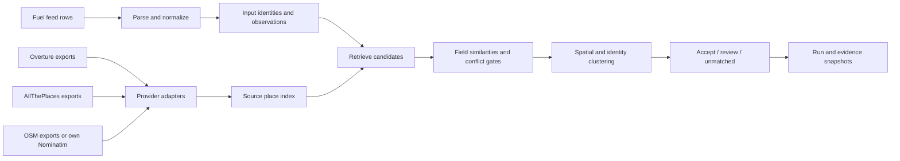

# Canonical address and geocoding design

## Scope and pipeline



The resolver runs against imported candidates in PostgreSQL. Network access is an explicit, separate ingestion operation. `run_geocoding_pipeline` orchestrates source acquisition, atomic imports, resolution and combined/per-source exports. It never invents a coordinate from an exit number or city center.

## Address contract

`CanonicalAddress` is the shared Pydantic data contract. The database stores its JSON representation and indexes selected fields. Raw names and address descriptions are retained alongside normalized values. The generated JSON Schema is in `canonical-address.schema.json`; the complete requested example is in `../examples/kwik-trip-normalized.json`.

```json
{
  "brand": "KWIK TRIP",
  "store_id": "796",
  "city": "TOMAH",
  "state": "WI",
  "country": "US",
  "highways": [
    {"network": "interstate", "number": "94", "jurisdiction": "US", "variant": "main"},
    {"network": "us_highway", "number": "12", "jurisdiction": "US", "variant": "main"},
    {"network": "state_route", "number": "21", "jurisdiction": "US-WI", "variant": "main"}
  ],
  "exits": [
    {"identifier": "143", "highway_key": "US:interstate:94:main", "association": "inferred_preceding_route"}
  ]
}
```

This excerpt omits raw fields and defaults for readability. `store_id` and route numbers are strings. Everything after the first `#` is retained as the store identifier; matching keys ignore whitespace and normalize purely numeric leading zeroes. Internal punctuation in alphanumeric IDs remains significant. Names without a marker have no invented store number. Brand aliases are explicit; Kwik Trip and QuikTrip remain distinct.

A highway reference has a **network**, **jurisdiction**, **number**, **variant** and optional travel **direction**. Networks include interstate, US, state, county, farm-to-market, provincial, Trans-Canada and unknown highway. Variants include main, business, alternate, bypass, spur and loop. A Wisconsin state route and a Minnesota state route with the same number are different references. An OSM road's functional class (`motorway`, `trunk`, etc.) belongs to the later road graph, not this route-number taxonomy.

`I-80/94` expands into two highway references. It does not establish which highway's exit numbering is intended, so the exit remains unassociated. `I-40, EXIT 280 & I-55, EXIT 4` preserves two distinct exit associations. Every association inferred from text is labeled as such and needs road-network verification. Highway lists describe access context; they do not assert that all listed roads intersect at one point.

Postal house number/street/unit fields coexist with highway clues. Unrecognized text, mileposts, named turnpikes and unsupported patterns stay in `unparsed_address` with warnings. This is a conservative US/Canada parser, not a complete postal grammar or a road topology engine.

## Persistence

| Django model | Responsibility |
| --- | --- |
| `FuelLocation` | Feed-scoped external identity, canonical input address, aliases, input conflict warnings and latest resolution |
| `FuelObservation` | Every raw feed row keyed by dataset SHA-256 and row number, exact Decimal price, explicit unknown currency/unit/time |
| `SourcePlace` | Latest record by provider/namespace/source ID, normalized address, WGS84 coordinate, precision, lifecycle, provenance and raw payload |
| `GeocodingRun` | Query snapshot, algorithm version, result and decision time |
| `MatchCandidate` | Per-run component scores and a full provider record snapshot |

Repeated feed rows do not become separate physical stations. They remain separate observations. Conflicting descriptions under one external ID are flagged for review; the first address is retained, all rows remain available, and automatic coordinate acceptance is disabled. A provider update does not alter evidence snapshots from previous runs. Latest coordinates must be re-resolved when source releases change.

## Similarity metric

Algorithm `evidence-2.0` scores weighted field similarity, coverage of the input's applicable clues, and absolute evidence strength. Business names exclude store identifiers. See [the complete scoring method, weights and export semantics](scoring-v2.md).

| Component | Weight |
| --- | ---: |
| Brand | 0.20 |
| Name | 0.10 |
| Store ID | 0.22 |
| City | 0.14 |
| State/province | 0.07 |
| Country | 0.03 |
| Postcode | 0.04 |
| Street | 0.08 |
| House number | 0.03 |
| Highway references | 0.07 |
| Scoped exit references | 0.02 |

Weights sum to 1. `A` is the weight of the clues present in the input. `W` is the weight of fields available on both records:

```text
coverage C = W / A
field similarity M = sum(w_i * s_i) / W
evidence strength E = min(1, W / 0.60)
score = 100 * M * sqrt(C) * E
```

Missing provider values reduce coverage. Absent input clues are recorded separately. Zero denominators give zero scores. The coverage and evidence-strength factors prevent sparse descriptions from receiving the same score as richly supported matches. This score is an explainable heuristic, **not a calibrated probability**.

Conflicting known country, state, store ID or house number sets the score to zero. Strong brand disagreement does too. Known brand Wikidata IDs take precedence over textual brand similarity. Overture's existence confidence is retained separately and is not used as a match probability; zero-confidence places are ineligible.

Initial acceptance requires all of:

1. Score at least 90, with at least 8 points over the next distinct location cluster.
2. Brand similarity at least 0.9 and exact store identity **or** matching house number and street similarity at least 0.95.
3. Exact country/state scope and either city similarity at least 0.85 or an exact known postcode.
4. A POI or POI-center coordinate from the winning cluster, with no known closure.
5. No input conflicts or truncated candidate search.

Scores of at least 65 enter review/ranking; lower or ineligible candidates remain visible in the audit output but cannot resolve the input. These starting thresholds require calibration against labeled truth before automated operational use. A high score alone never overrides the branch/locality checks.

## Cross-source record matching

Candidate records are scored against the input, then grouped only when identity evidence agrees and coordinates are within 250 m. Group admission checks every existing member, preventing a chain of nearby records from merging distant locations. Within that radius, an exact store ID, matching full street identity, or essentially identical name within 35 m is required. Store/house conflicts prevent merging adjacent branches.

Groups rank by their strongest member's input score. Duplicate records and multiple source names provide no score bonus. Provenance is exposed to reveal shared upstream data, including ATP-derived Overture records. The coordinate returned is an actual provider point chosen as the cluster medoid; coordinates are never averaged into an unobserved point.

If records with the same store identity disagree substantially in position, they form competing clusters and normally require review. No coordinates, city centroids, uncertain precision or insufficient branch evidence also require review. Review results expose proposed source records but keep the resolved coordinate null.

## Scaling and validation

The resolver filters by known country/state, permits missing source scope, then compares distinct city/brand keys before fetching eligible records and their JSON payloads. Store IDs remain an alternative locality block. Candidate enumeration is capped at 500 eligible records; reaching the cap prevents automatic acceptance. Batch runs restrict candidates to successfully imported releases. This favors inspectable behavior over silent truncation and is not a global search engine.

For national ingestion, stage fuel-only exports, use PostgreSQL/PostGIS with indexed normalized store/brand keys and `pg_trgm` city/name lookup, and run ingestion/resolution as background jobs. Add source-release activation, disappearance/staleness handling, bounding polygons for coordinate-vs-address checks, authoritative brand catalogs, road/exit spatial verification, expanded alternative-address matching and a review interface. Coordinate range checks alone do not establish that a point lies in its claimed state.

Measure candidate retrieval recall separately from ranking precision. Label store identity and real entrance/POI coordinates; stratify by brand, country, rural highway prose, missing IDs and adjacent chain locations. Tune weights/thresholds on a training set and report auto-accept precision, coverage, false merges, positional error and review rate on a held-out set. Tests with synthetic points validate behavior, not field accuracy. The current weights are hand-set starting values.

## Routing boundary for the next phase

The eventual API should distinguish fastest, cheapest and a configurable tradeoff. The fastest path and least-cost path are often different. A proposed objective is fuel purchased plus tolls plus a configurable value of travel/detour time, constrained by vehicle range, tank state, compatible fuel, access, opening hours and truck restrictions. Prices need consistent units, currencies and timestamps first, especially across US/Canada.

POI coordinates are not verified truck entrances. The routing graph must retain safe access points and snap them with HGV restrictions, directionality, height/weight limits and road connectivity. A cheaper station across a divided highway may be more costly to reach. Keep Django as the API/data orchestration layer; profile graph search before introducing a Rust/C++ engine through a stable service or extension boundary. No routing algorithm or routing endpoint is implemented in this geocoding milestone.
